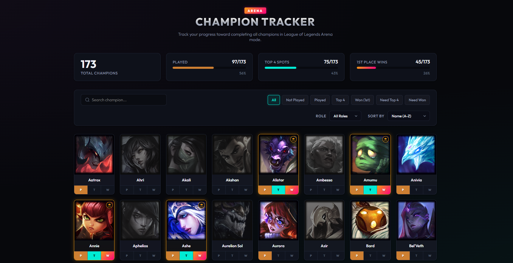

# League of Legends: Arena Champion Tracker


A sleek, interactive web dashboard to help you track your progress towards completing all champions in the **League of Legends: Arena** game mode — powered by a companion Python data pipeline that computes live Arena meta statistics.

<p align="center">
  
</p>

---

## 📖 About The Project

Playing Arena and want to keep track of who you've played, who you've hit Top 4 with, and who you've achieved a 1st Place Gladiator finish on? This tracker does exactly that. 

It provides a premium, Hextech-inspired UI that automatically fetches the latest champions from Riot Games, persists your progress locally, and surfaces live **Arena meta statistics** (tiers, augments, items, build styles) computed by a companion Python data pipeline. Each champion's tier badge still links straight to the best MetaSrc build.

## ✨ Key Features

- **3-Tier Progression Tracking:** 
  - **Played (Bronze):** You've played the champion.
  - **Top 4 (Silver/Teal):** You've placed in the top 4.
  - **Won 1st Place (Gold/Pink):** You've achieved ultimate victory.
- **Smart Status Toggles:** The UI handles hierarchical logic natively. Toggling a "Win" automatically cascades to mark "Top 4" and "Played".
- **Dynamic Filtering & Search:** Filter your roster by class role (Assassin, Tank, Support, etc.), missing completions, or sort them alphabetically and by progress.
- **In-App Arena Meta Modal:** Click a champion portrait to open a rich, data-driven breakdown — tier, win rate, Top-4 rate, augments by rarity (with tier + pick %), boots, items by round, prismatic items, late-game elixirs, skill order, and a **Build Style** switcher (Recommended, AD, Crit, MS, CDR, HP, On-Hit, Lethality, MR, AP, AR, LS, Mana, SV). Item/augment icons have hover tooltips with descriptions and colored keyword stats.
- **MetaSrc Shortcut:** The champion's tier badge (`S+ … C`) links directly to the best MetaSrc build.
- **Live Patch Badge:** The header shows the current Arena patch served by the data pipeline.
- **Live Server Latency / Ping Meter:** Embedded live ping monitor right in the header measuring real-time latency directly to Riot's game servers (LAN by default, with quick selector for NA, LAS, EUW, BR). Features color-coded quality indicators, one-click re-testing, auto-refresh, and diagnostic links.
- **Automated Riot API Sync:** Auto-syncs with Riot's Data Dragon API on startup. When a new champion is released in League of Legends, they instantly appear in your app (while stripping out duplicate event/TFT variants).
- **Persistent Storage:** Your progress is saved in a local SQLite database and mounted securely via Docker Volumes, meaning your data survives app restarts and container updates.

---

## 🚀 Installation & Usage

The recommended and easiest way to run the application is via **Docker**. This ensures you don't need to install Node.js, manage dependencies, or configure a local database environment.

### Prerequisites
- [Docker Desktop](https://www.docker.com/products/docker-desktop/) installed and running.

### 1. Docker Quick Start (Recommended)

1. **Clone the repository:**
   ```bash
   git clone https://github.com/luisaga215/lol_champion_tracker.git
   cd lol_champion_tracker
   ```
2. **Start the application** (this also builds & starts the Python `arena-pipeline` service):
   - **Windows:** Double-click the `run_arena_tracker.bat` file.
   - **Mac/Linux/Terminal:** Run the following command:
     ```bash
     docker compose up -d --build
     ```
   > To power the Arena meta statistics, add your Riot key to a `.env` file in the repo root (`RIOT_API_KEY=RGAPI-...`) before starting. The key is never committed (`.env` is gitignored).

3. **Open the App:** Navigate to [http://localhost:3000](http://localhost:3000) in your web browser. *(Note: The first startup takes 10-15 seconds to download the latest high-res champion portraits).*

### 2. Local Setup (Without Docker)

If you prefer to run the application natively for development:

1. Ensure **Node.js** (v18+) and npm are installed.
2. Clone the repo and navigate to the directory.
3. Install dependencies:
   ```bash
   npm install
   ```
4. Start the application:
   ```bash
   npm start
   ```
5. View at `http://localhost:3000`.

---

## 📂 Project Structure

```text
lol_champion_tracker/
├── src/
│   ├── public/                # Frontend UI (HTML, CSS, Vanilla JS, SVG favicon)
│   ├── server.js              # Express.js REST API Backend (+ /api/arena proxy)
│   ├── init_db.js             # SQLite initialization & Riot Data Dragon fetcher logic
│   └── server.test.js         # Backend unit tests (Jest)
├── lol_arena_data_pipeline/   # Python FastAPI Arena data pipeline & meta API
│   └── README.md              # Full pipeline documentation
├── data/                      # Auto-generated directory for SQLite DB and cached images
├── docker-compose.yml         # Docker orchestration (tracker + pipeline)
├── Dockerfile                 # Node.js container build instructions
└── run_arena_tracker.bat      # Helper script for easy Windows execution
```

---

## 🧪 Running Tests

If you're contributing or modifying the codebase, you can run the test suite:
```bash
npm run test
```
Tests use **Jest** and **Supertest** to validate the REST API endpoints using an in-memory test database, ensuring no regressions.

The companion data pipeline has its own test suite:
```bash
cd lol_arena_data_pipeline
pytest
```

---

## 🐍 Arena Data Pipeline

Arena meta statistics (tiers, augments, boots, items by round, prismatic items,
elixirs, skill order, and build-style archetypes) are computed by the
**`lol_arena_data_pipeline`** Python/FastAPI microservice. It crawls real Arena
matches via the Riot match-v5 API, enriches them with CommunityDragon data, and
serves the results; the tracker proxies `/api/arena/*` to it.

See [`lol_arena_data_pipeline/README.md`](./lol_arena_data_pipeline/README.md) for
full documentation (architecture, configuration, API reference, and data model).

---

## 📝 License & Disclaimer

This project is open-source and licensed under the **MIT License**.

**Disclaimer:** *This project is not affiliated with, endorsed, or sponsored by Riot Games. League of Legends champion data, names, and imagery are property and trademarks of Riot Games, Inc.*
